# 📋 Trello Clone - Nền Tảng Quản Lý Công Việc & Dự Án Thời Gian Thực

[](https://react.dev/)
[](https://vitejs.dev/)
[](https://mui.com/)
[](https://redux-toolkit.js.org/)
[](https://socket.io/)
[](https://securityheaders.com/?q=https%3A%2F%2Ftrello-web-tawny.vercel.app%2F&followRedirects=on)
[](https://trello-web-tawny.vercel.app)

> Một ứng dụng quản lý công việc và dự án theo phương pháp **Kanban**, lấy cảm hứng từ Trello, được xây dựng với kiến trúc **Full-stack MERN** hiện đại, mượt mà và tối ưu hóa trải nghiệm người dùng với tính năng cộng tác thời gian thực (**Real-time Collaboration**).

---

## 🌐 Trải Nghiệm Trực Tuyến (Live Demo)

- 🚀 **Frontend Web App**: [https://trello-web-tawny.vercel.app](https://trello-web-tawny.vercel.app)
- ⚙️ **Backend RESTful API**: [https://trello-api-5hh5.onrender.com](https://trello-api-5hh5.onrender.com)
- 📦 **Tài khoản dùng thử / Test Account**: Bạn có thể tự đăng ký tài khoản mới hoặc đăng nhập trực tiếp bằng **Google Account** chỉ với 1 click!

---

## ✨ Tính Năng Nổi Bật (Key Features)

- ⚡ **Kanban Board Kéo Thả Mượt Mà (`@dnd-kit`)**: Kéo thả thẻ (Cards) và danh sách (Columns) linh hoạt, hỗ trợ tự động tính toán vị trí và cập nhật trạng thái tức thì.
- 🔄 **Cộng Tác Thời Gian Thực (Socket.IO)**: Đồng bộ mọi thay đổi (thêm, sửa, di chuyển thẻ, cập nhật thành viên) giữa tất cả người dùng trong board ngay lập tức mà không cần tải lại trang.
- ⏰ **Quản Lý Hạn Chót & Nhắc Hẹn Tự Động (Due Date & Reminder)**: Thiết lập deadline cho thẻ kèm thời gian nhắc nhở linh hoạt (10 phút, 1 giờ, 1 ngày...). Tự động gắn nhãn cảnh báo **"DUE SOON"** và **"OVERDUE"**.
- 🔔 **Trung Tâm Thông Báo Đa Năng (Notification Center)**: Tích hợp thông báo lời mời tham gia bảng và nhắc nhở công việc sắp hết hạn/quá hạn; hỗ trợ *Đánh dấu tất cả đã đọc*, *Xóa tất cả* hoặc loại bỏ từng thông báo riêng lẻ.
- 📝 **Không Gian Chi Tiết Thẻ Đầy Đủ (Card Modal Workspace)**:
  - Soạn thảo mô tả bằng **Markdown Editor**.
  - Quản lý danh sách công việc con (**Checklist**) với thanh tiến độ % sinh động.
  - Tải lên hình ảnh / tệp đính kèm và đặt làm ảnh bìa thẻ (**Cloudinary**).
  - Hệ thống nhãn màu (**Labels**) đa dạng (Urgent, Bug, Feature, Enhancement, Documentation...).
  - Tính năng **Sao chép thẻ (Copy Card)** thông minh.
  - Bình luận và trao đổi trực tiếp trên từng thẻ.
- 🛡️ **Bảo Mật Cao Cấp & Cơ Chế Dual-Auth**:
  - Xác thực kép linh hoạt kết hợp **HttpOnly Cookie** và **Authorization Bearer Token**, giải quyết triệt để lỗi chặn cookie của trình duyệt di động / Safari (ITP).
  - Tích hợp đăng nhập nhanh qua **Google OAuth 2.0**.
  - Cấu hình an toàn bảo mật HTTP Headers đạt **Điểm A (Grade A)** trên *Security Headers*.
- 🎨 **Giao Diện Hiện Đại & Tương Thích Di Động (Responsive & Theming)**:
  - Tùy chỉnh chế độ **Dark / Light Mode**.
  - Đổi hình nền Board theo sở thích (kho ảnh chất lượng cao).
  - Phân trang tập trung cho danh sách bảng công việc (Pagination).
  - Tương thích tốt trên máy tính để bàn, máy tính bảng và điện thoại thông minh.

---

## 📸 Hướng Dẫn Sử Dụng Chi Tiết & Hình Ảnh Minh Họa

### 0. Trang Giới Thiệu (Landing Page)
Trang đích hiện đại, trực quan giới thiệu các giá trị cốt lõi của ứng dụng cùng các lối tắt trải nghiệm nhanh.

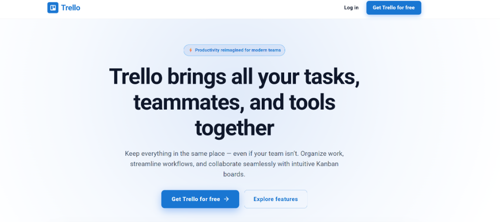

---

### 1. Không Gian Bảng Làm Việc (Kanban Board)
Giao diện làm việc chính trực quan, hiển thị các cột trạng thái cùng các thẻ công việc. Người dùng có thể kéo thả thẻ giữa các cột hoặc di chuyển vị trí cột một cách tự nhiên.

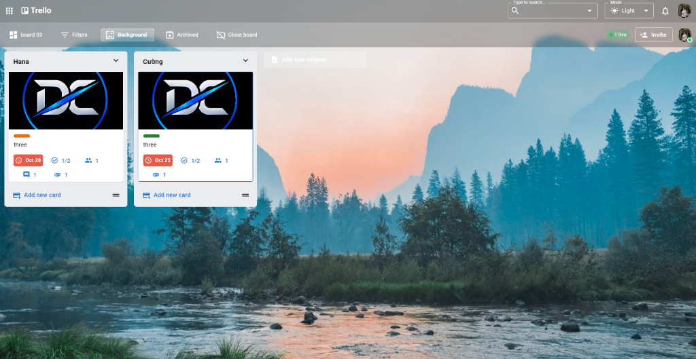

- **Bộ lọc thẻ thông minh (Filter Cards)**: Tìm kiếm thẻ theo từ khóa, lọc theo thành viên được giao việc, hoặc lọc theo nhãn màu (Urgent, Enhancement, Bug...).
- **Đổi ảnh nền (Background)**: Tùy biến hình nền không gian làm việc giúp tăng cảm hứng và phân biệt các dự án khác nhau.

---

### 2. Cộng Tác Thời Gian Thực Đa Người Dùng (Real-time Collaboration)
Mọi thao tác di chuyển thẻ, kéo thả cột, đổi tiến độ hay thêm bình luận đều được phát sóng tức thì đến tất cả thành viên đang mở bảng thông qua **Socket.IO**.

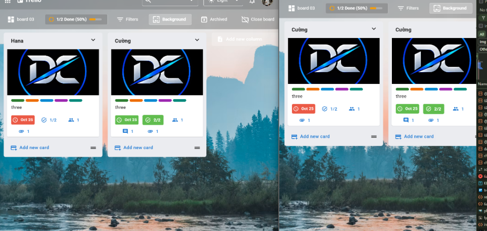

- Đèn báo trạng thái số lượng thành viên đang trực tuyến (**Live Indicator**).
- Tránh xung đột dữ liệu và tăng tốc độ làm việc nhóm.

---

### 3. Chi Tiết Thẻ Công Việc & Thanh Tiến Độ (Card Workspace & Checklist)
Bấm vào bất kỳ thẻ nào để mở giao diện quản lý chi tiết với đầy đủ công cụ phục vụ công việc.

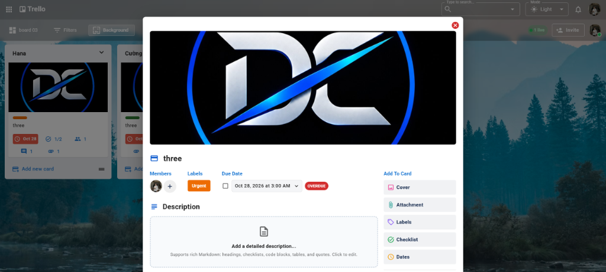

- **Checklist**: Liệt kê các đầu việc con cần hoàn thành; thanh tiến độ % tự động cập nhật theo thời gian thực (0% - 100%) và chuyển sang màu xanh lá cây khi hoàn tất.
- **Hạn chót & Nhắc nhở (Due Date & Reminder)**: Chọn ngày giờ kết thúc công việc và mốc thời gian hệ thống nhắc nhở bạn trước khi hết hạn.
- **Nhãn phân loại (Labels)**: Gắn màu sắc tương ứng với mức độ ưu tiên hoặc loại công việc.
- **Thảo luận (Activity)**: Viết bình luận, phản hồi và theo dõi lịch sử hoạt động của thẻ.

---

### 4. Bảng Điều Khiển & Danh Sách Dự Án (Boards Dashboard)
Màn hình tổng hợp toàn bộ các bảng dự án cá nhân và nhóm mà bạn tham gia.

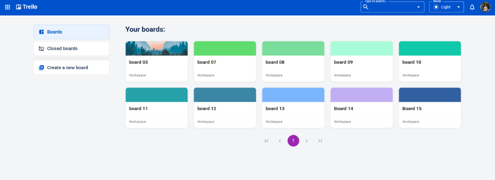

- Hỗ trợ tạo mới bảng dự án với tên gọi và màu sắc/hình nền đại diện riêng.
- Thanh điều hướng bên trái phân loại rõ: *Boards đang hoạt động*, *Closed boards (Đã đóng)* và *Tạo bảng mới*.
- Hệ thống phân trang căn giữa (Pagination) thuận tiện khi số lượng bảng tăng lên.

---

### 5. Trung Tâm Thông Báo Thông Minh (Notification Center)
Biểu tượng quả chuông trên thanh AppBar giúp bạn không bỏ lỡ bất kỳ sự kiện quan trọng nào.

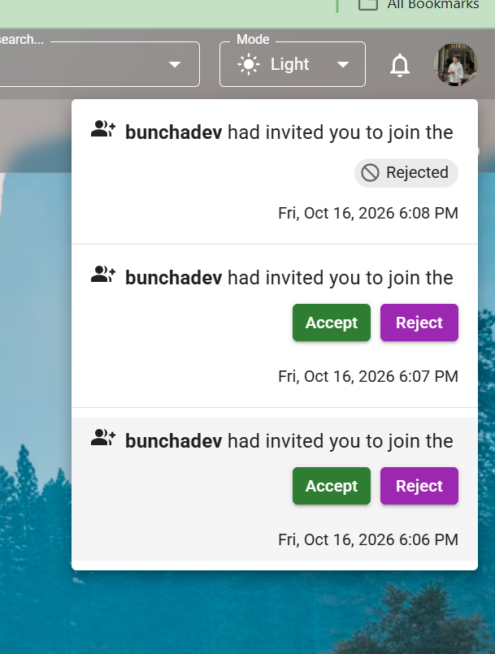

- **Lời mời tham gia bảng (Board Invitations)**: Nhận lời mời từ đồng nghiệp kèm 2 nút **Accept** hoặc **Reject** trực tiếp.
- **Nhắc nhở hạn chót (Deadline Alerts)**: Cảnh báo thẻ sắp đến hạn hoặc đã quá hạn; nhấn trực tiếp vào thông báo sẽ tự động chuyển đến bảng và mở đúng thẻ cần xử lý.
- **Thao tác nhanh**:
  - Đánh dấu tất cả đã đọc (**Mark all as read**).
  - Xóa toàn bộ danh sách thông báo (**Clear all**).
  - Loại bỏ từng thông báo một với biểu tượng nút `x`.

---

### 6. Sao Chép Thẻ & Quản Lý Tệp Đính Kèm (Advanced Actions)
Tối ưu hóa năng suất với các tính năng chuyên nghiệp:

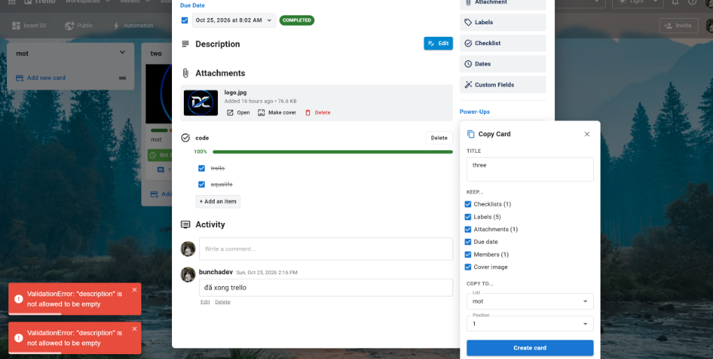

- **Sao chép thẻ (Copy Card)**: Nhân bản nhanh một thẻ sang cột khác hoặc bảng khác, tùy chọn giữ lại Checklists, Labels, Attachments, Due Date, Members hoặc Cover Image.
- **Tệp đính kèm (Attachments)**: Tải lên hình ảnh/tài liệu, xem trước hình ảnh sắc nét, chọn ảnh làm cover đại diện hiển thị ngoài bảng Kanban.

---

### 7. Quản Lý Vòng Đời Dự Án (Closed Boards)
Khi một dự án đã hoàn thành, bạn có thể đóng bảng để giữ không gian làm việc luôn gọn gàng.

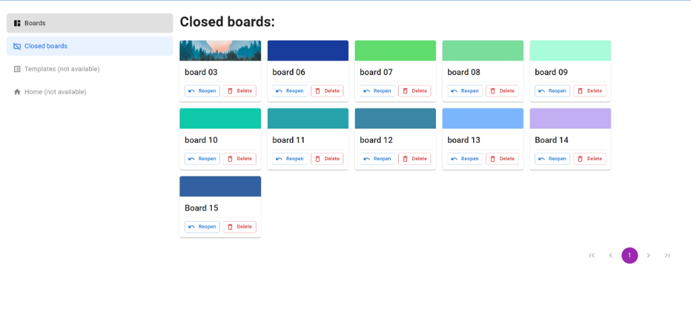

- Xem danh sách toàn bộ các bảng đã đóng.
- Tùy chọn **Reopen** (Khôi phục lại hoạt động) hoặc **Delete** (Xóa vĩnh viễn bảng khỏi hệ thống).

---

### 8. Đăng Ký, Đăng Nhập & Bảo Mật Đạt Chuẩn A

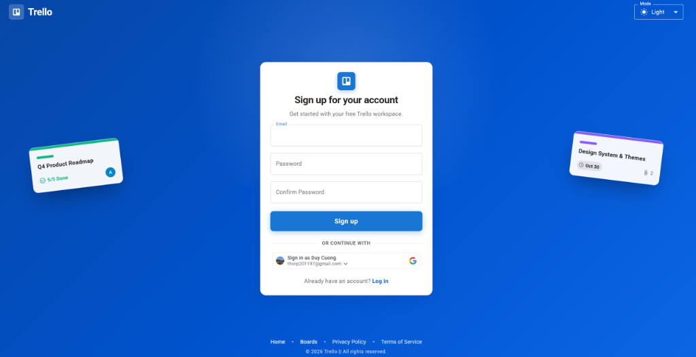

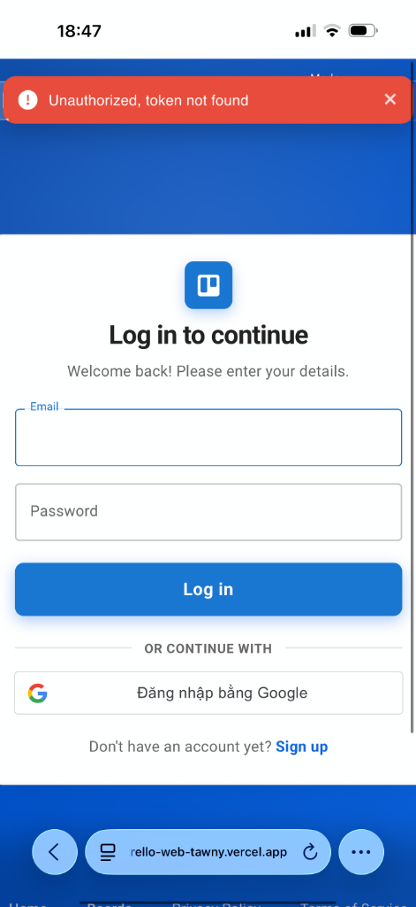

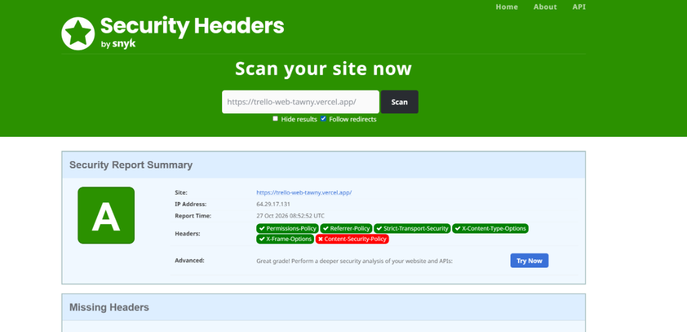

- **Quy trình đăng ký chuẩn xác**: Gửi email xác thực tài khoản qua **Brevo** trước khi kích hoạt.
- **Đăng nhập Google**: Tích hợp nút **Sign in with Google** chính thống, hỗ trợ đăng nhập 1 chạm an toàn.
- **Dual-Auth Security**: Bảo mật chống tấn công XSS/CSRF với HttpOnly Cookies, kết hợp Bearer Token giúp người dùng trên Safari/iOS không bao giờ bị gián đoạn phiên làm việc.
- **Điểm A Bảo Mật**: Kiểm tra trên **Security Headers** xác nhận cấu hình bảo vệ đầy đủ các chính sách bảo mật HTTP.

---

## 🛠 Công Nghệ Sử Dụng (Tech Stack)

### Frontend (`trello-web`)
- **Core**: React 18, Vite
- **UI Framework & Icons**: Material UI (MUI v5), `@emotion/react`, `@emotion/styled`, `@mui/icons-material`
- **Kéo thả (DnD)**: `@dnd-kit/core`, `@dnd-kit/sortable`, `@dnd-kit/utilities`
- **Quản lý State**: Redux Toolkit, Redux Persist
- **Real-time Client**: `socket.io-client`
- **HTTP Client**: Axios (với Request & Response Interceptors xử lý Dual-Auth và tự động Refresh Token)
- **Editor & Formatting**: `@uiw/react-md-editor`, Day.js, Lodash
- **Xác thực**: `@react-oauth/google`

### Backend (`trello-api`)
- **Runtime & Framework**: Node.js (>=18.x), Express.js
- **Database**: MongoDB (Native MongoDB Node.js Driver)
- **Real-time Engine**: Socket.IO
- **Validation**: Joi
- **Xác thực & Mã hóa**: JSON Web Token (`jsonwebtoken`), `bcryptjs`, `cookie-parser`, `google-auth-library`
- **Email Service**: Brevo API (`@getbrevo/brevo`)
- **Quản lý Media**: Cloudinary SDK
- **Bảo mật**: `cors`, `express-rate-limit`

---

## 🚀 Hướng Dẫn Cài Đặt & Chạy Cục Bộ (Local Setup)

### Yêu Cầu Tiên Quyết (Prerequisites)
- [Node.js](https://nodejs.org/) phiên bản **>= 18.x**
- [npm](https://www.npmjs.com/) hoặc [yarn](https://yarnpkg.com/)
- Cơ sở dữ liệu [MongoDB](https://www.mongodb.com/) (Local hoặc MongoDB Atlas)

---

### 1. Khởi Chạy Frontend (`trello-web`)

```bash
# Di chuyển vào thư mục trello-web
cd trello-web

# Cài đặt các thư viện cần thiết
npm install

# Tạo file cấu hình môi trường từ file mẫu
cp .env.example .env
```

Nội dung cấu hình trong file `.env`:
```env
VITE_GOOGLE_CLIENT_ID=your_google_client_id_here
```

Khởi chạy máy chủ phát triển (Development Server):
```bash
npm run dev
```
Ứng dụng sẽ hoạt động tại địa chỉ: `http://localhost:5173`

---

### 2. Khởi Chạy Backend API (`trello-api`)

```bash
# Di chuyển vào thư mục trello-api
cd ../trello-api

# Cài đặt các thư viện phụ thuộc
npm install

# Tạo file cấu hình môi trường
cp .env.example .env
```

Cấu hình các thông số trong file `.env` của `trello-api`:
```env
LOCAL_DEV_APP_HOST=localhost
LOCAL_DEV_APP_PORT=8017

MONGODB_URI=mongodb+srv://<username>:<password>@cluster0.mongodb.net/?retryWrites=true&w=majority
DATABASE_NAME=trello-db

AUTHOR=Duy Cuong

BUILD_MODE=dev

WEBSITE_DOMAIN_DEVELOPMENT=http://localhost:5173
WEBSITE_DOMAIN_PRODUCTION=https://trello-web-tawny.vercel.app

BREVO_API_KEY=your_brevo_api_key
ADMIN_EMAIL_ADDRESS=your_email@example.com
ADMIN_EMAIL_NAME=Trello Admin

ACCESS_TOKEN_SECRET_SIGNATURE=your_access_token_secret
ACCESS_TOKEN_LIFE=1h
REFRESH_TOKEN_SECRET_SIGNATURE=your_refresh_token_secret
REFRESH_TOKEN_LIFE=14d

CLOUDINARY_CLOUD_NAME=your_cloudinary_name
CLOUDINARY_API_KEY=your_cloudinary_key
CLOUDINARY_API_SECRET=your_cloudinary_secret
```

Khởi chạy API Server:
```bash
npm run dev
```
API Server sẽ hoạt động tại địa chỉ: `http://localhost:8017`

---

## 📁 Cấu Trúc Thư Mục Dự Án (Project Structure)

```text
trello/
├── trello-web/                   # Ứng dụng Frontend (React + Vite)
│   ├── public/                   # Tài nguyên tĩnh (Favicon, Robots.txt, Sitemap)
│   ├── screenshots/              # Ảnh chụp giao diện minh họa cho tài liệu
│   └── src/
│       ├── apis/                 # API client calls (Axios endpoints)
│       ├── assets/               # Hình ảnh, icons, vectors
│       ├── components/           # Components tái sử dụng (AppBar, Modal, Dialog...)
│       ├── customHooks/          # React Custom Hooks
│       ├── customLibraries/      # Cấu hình thư viện ngoài (Dnd-kit sensor...)
│       ├── pages/                # Các trang chính (Auth, Boards, Settings, 404...)
│       │   ├── Auth/             # Đăng ký, đăng nhập, kích hoạt tài khoản
│       │   └── Boards/           # Bảng Kanban, BoardBar, BoardContent, Columns, Cards
│       ├── redux/                # Redux Toolkit Slices & Store configuration
│       ├── theme.js              # Cấu hình giao diện MUI Theming & Colors
│       └── utils/                # Utilities, constants, validators, token helpers
│
└── trello-api/                   # Ứng dụng Backend API (Node.js + Express)
    └── src/
        ├── config/               # Cấu hình môi trường, CORS, Cloudinary, MongoDB
        ├── controllers/          # Request handlers xử lý logic HTTP
        ├── middlewares/          # Auth middleware (Dual-auth), multer upload...
        ├── models/               # MongoDB Database Schemas & Data access layer
        ├── providers/            # Third-party providers (Brevo Email, Cloudinary)
        ├── routes/v1/            # Định tuyến RESTful API v1
        ├── services/             # Business logic nghiệp vụ
        ├── sockets/              # Socket.IO event handlers (real-time emit/listen)
        ├── utils/                # Formatters, algorithms, JWT helpers
        ├── validations/          # Joi schema validations
        └── server.js             # Entrypoint khởi tạo Express & Socket.IO server
```

---

## 🚢 Hướng Dẫn Triển Khai (Deployment)

### Frontend Deployment (Vercel)
1. Kết nối kho lưu trữ GitHub `Trello_Web` với dự án trên **Vercel**.
2. Thiết lập thư mục gốc (**Root Directory**) là thư mục `trello-web` (nếu dùng monorepo) hoặc chọn nhánh `master`.
3. Thêm biến môi trường:
   - `VITE_GOOGLE_CLIENT_ID`: Google OAuth Client ID của bạn.
4. Vercel sẽ tự động build và cung cấp chứng chỉ SSL miễn phí.

### Backend Deployment (Render)
1. Tạo một **Web Service** mới trên **Render** kết nối với kho lưu trữ `Trello_Api`.
2. Cấu hình lệnh:
   - **Build Command**: `npm install && npm run build`
   - **Start Command**: `npm run start`
3. Khai báo toàn bộ các biến môi trường từ file `.env` vào mục **Environment** trên Render.

---

## 👨‍💻 Tác Giả (Author)

- **Nguyễn Duy Cường** (*duycuongdev*)
- **GitHub**: [@duycuongdev](https://github.com/duycuongdev)
- **Dự án**:
  - [Trello_Web Repository](https://github.com/duycuongdev/Trello_Web)
  - [Trello_Api Repository](https://github.com/duycuongdev/Trello_Api)

---

## 📄 Bản Quyền (License)

Dự án này được phát triển phục vụ mục đích học tập, nghiên cứu và xây dựng sản phẩm chất lượng cao. Giữ toàn quyền tác giả bởi Nguyễn Duy Cường.

