# 📋 Trello Clone - Nền Tảng Quản Lý Công Việc & Dự Án Thời Gian Thực

[](https://react.dev/)
[](https://vitejs.dev/)
[](https://mui.com/)
[](https://redux-toolkit.js.org/)
[](https://socket.io/)
[](https://cloudinary.com/)
[](https://www.brevo.com/)
[](https://trello-web-tawny.vercel.app)

> Một ứng dụng quản lý công việc và dự án theo phương pháp **Kanban**, lấy cảm hứng từ Trello, được xây dựng với kiến trúc **Full-stack MERN** hiện đại, mượt mà và tối ưu hóa trải nghiệm người dùng với tính năng cộng tác thời gian thực (**Real-time Collaboration**).

---

## 🌐 Trải Nghiệm Trực Tuyến (Live Demo)

- 🚀 **Frontend Web App**: [https://trello-web-tawny.vercel.app](https://trello-web-tawny.vercel.app)
- ⚙️ **Backend RESTful API**: [https://trello-api-5hh5.onrender.com](https://trello-api-5hh5.onrender.com)
- 📦 **Tài khoản dùng thử / Test Account**: Bạn có thể tự đăng ký tài khoản mới hoặc đăng nhập trực tiếp bằng **Google Account** chỉ với 1 click!

---

## ✨ Tính Năng Nổi Bật (Key Features)

- ⚡ **Kanban Board Kéo Thả Trực Quan (`@dnd-kit`)**: Kéo thả thẻ (Cards) và danh sách (Columns) mượt mà, tự động tính toán vị trí và lưu trữ tức thì.
- 🔄 **Cộng Tác Thời Gian Thực (Socket.IO)**: Đồng bộ mọi thay đổi (thêm, sửa, di chuyển thẻ, cập nhật thành viên) giữa tất cả người dùng trong board ngay lập tức mà không cần tải lại trang.
- ⏰ **Hạn Chót & Nhắc Hẹn Thông Minh (Due Date & Alerts)**: Thiết lập deadline cho thẻ kèm thời gian nhắc nhở linh hoạt (10 phút, 1 giờ, 1 ngày...). Tự động gắn nhãn cảnh báo **"DUE SOON"** và **"OVERDUE"**.
- 🔔 **Trung Tâm Thông Báo (Notification Center)**: Tích hợp thông báo lời mời tham gia bảng và nhắc nhở công việc sắp hết hạn/quá hạn; hỗ trợ *Đánh dấu tất cả đã đọc*, *Xóa tất cả* hoặc loại bỏ từng thông báo.
- 📝 **Chi Tiết Thẻ Công Việc Toàn Diện (Card Workspace)**:
  - Soạn thảo mô tả trực quan bằng **Markdown Editor**.
  - Quản lý danh sách công việc con (**Checklist**) với thanh tiến độ % sinh động.
  - Tải lên hình ảnh / tệp đính kèm và đặt làm ảnh bìa thẻ (**Cloudinary**).
  - Hệ thống nhãn màu (**Labels**) đa dạng (Urgent, Bug, Feature, Enhancement, Documentation...).
  - Thao tác nâng cao: Di chuyển thẻ (Move), Nhân bản thẻ (Copy Card), Lưu trữ (Archive) và Xóa (Delete).
  - Bình luận và tương tác trực tiếp trên từng thẻ.
- 🎨 **Tùy Biến Giao Diện Linh Hoạt**:
  - Hỗ trợ đổi hình nền Board phong phú (kho ảnh Unsplash, Gradients, Colors hoặc Upload ảnh cá nhân).
  - Hỗ trợ chế độ **Dark / Light Mode**.
  - Phân trang tập trung cho danh sách bảng công việc (Pagination).
- 🛡️ **Bảo Mật Cao Cấp & Cơ Chế Dual-Auth**:
  - Xác thực kép linh hoạt kết hợp **HttpOnly Cookie** và **Authorization Bearer Token**, giải quyết triệt để lỗi chặn cookie của trình duyệt di động / Safari (ITP).
  - Đăng nhập 1 chạm an toàn qua **Google OAuth 2.0**.
  - Cấu hình an toàn bảo mật HTTP Headers đạt chuẩn cao.

---

## 📸 Hướng Dẫn Sử Dụng Chi Tiết & Bộ Sưu Tập Giao Diện

### 1. Trang Giới Thiệu (Landing Page)
Trang đích hiện đại, trực quan giới thiệu các giá trị cốt lõi của nền tảng cùng các nút điều hướng nhanh đến đăng ký và đăng nhập.

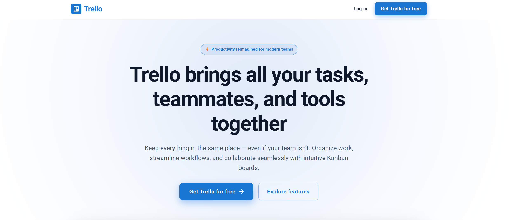

---

### 2. Đăng Ký Tài Khoản & Đăng Nhập Google (Sign Up & Authentication)
Giao diện đăng ký tài khoản với tính năng xác thực email kích hoạt qua **Brevo**, tích hợp đăng nhập nhanh 1 chạm bằng **Google OAuth 2.0**.

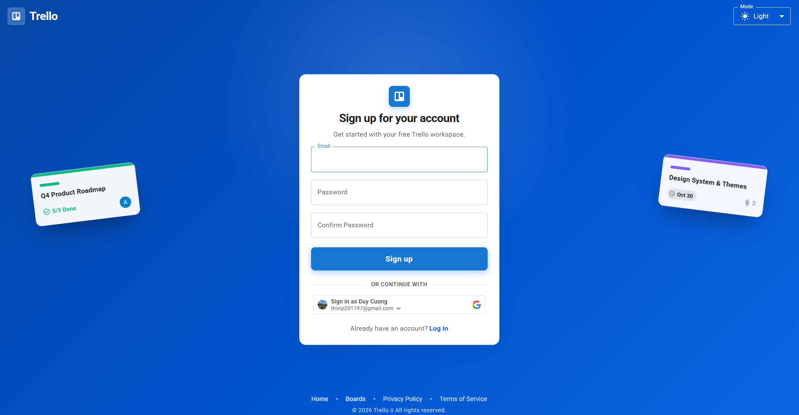

---

### 3. Không Gian Quản Lý Dự Án (Boards Dashboard)
Màn hình tổng hợp toàn bộ các bảng dự án cá nhân và nhóm mà bạn tham gia với màu sắc/ảnh đại diện riêng biệt, hỗ trợ tìm kiếm và phân trang căn giữa tiện lợi.

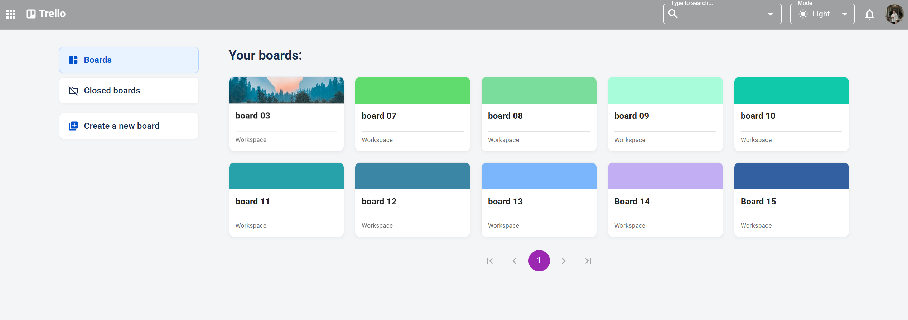

---

### 4. Quản Lý Bảng Đã Đóng (Closed Boards Lifecycle)
Khi một dự án đã hoàn tất, người dùng có thể đóng bảng để giữ không gian làm việc gọn gàng. Trang Closed Boards cho phép **Reopen** (Khôi phục) hoặc **Delete** (Xóa vĩnh viễn) an toàn.

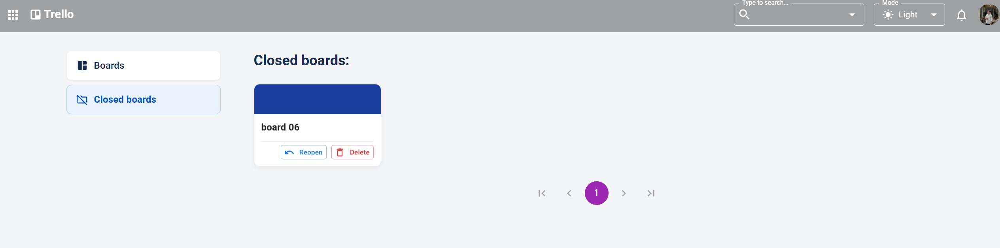

---

### 5. Cài Đặt Hồ Sơ Cá Nhân (Account Settings)
Trang quản lý thông tin tài khoản cho phép người dùng cập nhật ảnh đại diện (Avatar), xem email và thay đổi tên hiển thị (Display Name).

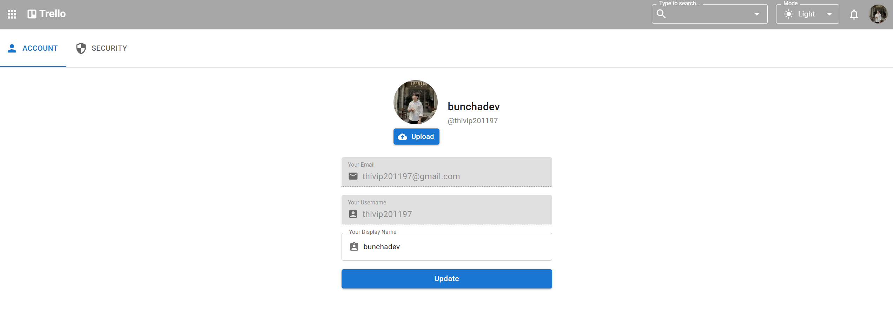

---

### 6. Bảng Điều Khiển Bảo Mật (Security Dashboard)
Cung cấp khu vực đổi mật khẩu tài khoản an toàn, yêu cầu xác nhận mật khẩu hiện tại trước khi thiết lập mật khẩu mới.

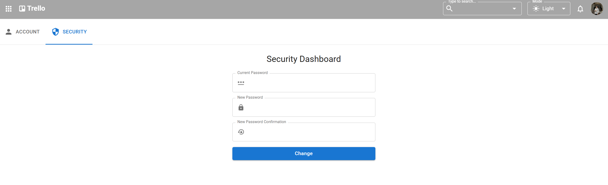

---

### 7. Menu Người Dùng & Lối Tắt Nhanh (User Profile Menu)
Menu góc phải thanh điều hướng giúp truy cập nhanh vào Hồ sơ (Profile), Hướng dẫn trải nghiệm (Product Tour), Danh sách phím tắt (Shortcuts), Cài đặt (Settings) và Đăng xuất (Logout).

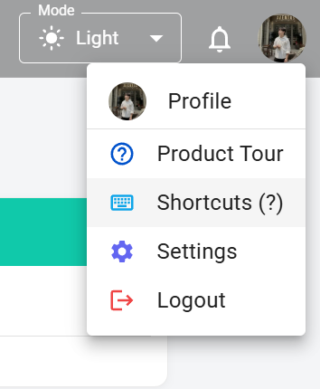

---

### 8. Không Gian Bảng Làm Việc (Kanban Board)
Giao diện làm việc chính hiển thị các cột trạng thái cùng các thẻ công việc. Hỗ trợ kéo thả mượt mà với `@dnd-kit`, hiển thị số lượng thành viên đang trực tuyến theo thời gian thực (**1 live**).

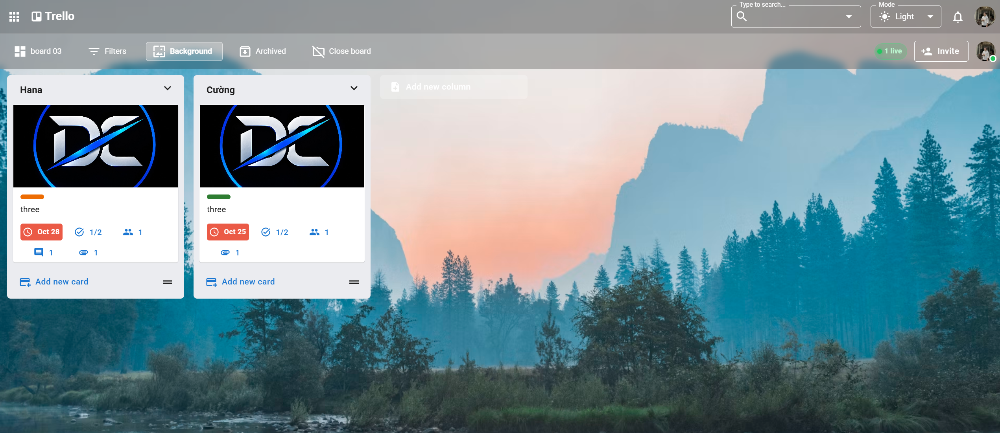

---

### 9. Chi Tiết Thẻ & Cảnh Báo Quá Hạn (Card Overview & Overdue Alert)
Nhấp vào bất kỳ thẻ nào để mở modal chi tiết: hiển thị ảnh bìa nổi bật, nhãn phân loại (**Urgent**), hạn chót với huy hiệu cảnh báo đỏ **OVERDUE** khi quá hạn, và khung soạn thảo mô tả Markdown.

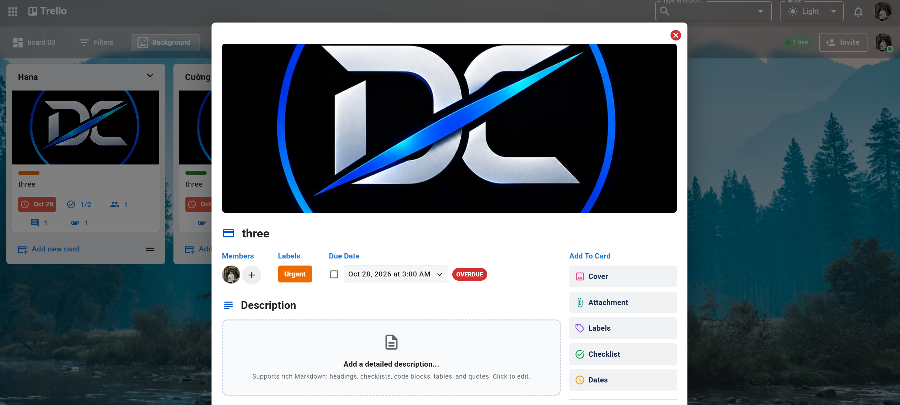

---

### 10. Quản Lý Tệp Đính Kèm, Tiến Độ Checklist & Bình Luận (Card Details)
Khu vực nội dung chi tiết phía dưới của thẻ:
- **Tệp đính kèm (Attachments)**: Xem trước hình ảnh, tải về hoặc đặt làm ảnh bìa thẻ.
- **Danh sách việc cần làm (Checklist)**: Tích chọn hoàn thành đầu việc, thanh tiến độ % tự động cập nhật trực quan.
- **Bình luận & Thảo luận (Activity)**: Trao đổi theo thời gian thực cùng đồng đội.
- **Hành động nâng cao**: Xóa thẻ (Delete), Di chuyển (Move), Sao chép (Copy) hoặc Lưu trữ (Archive).

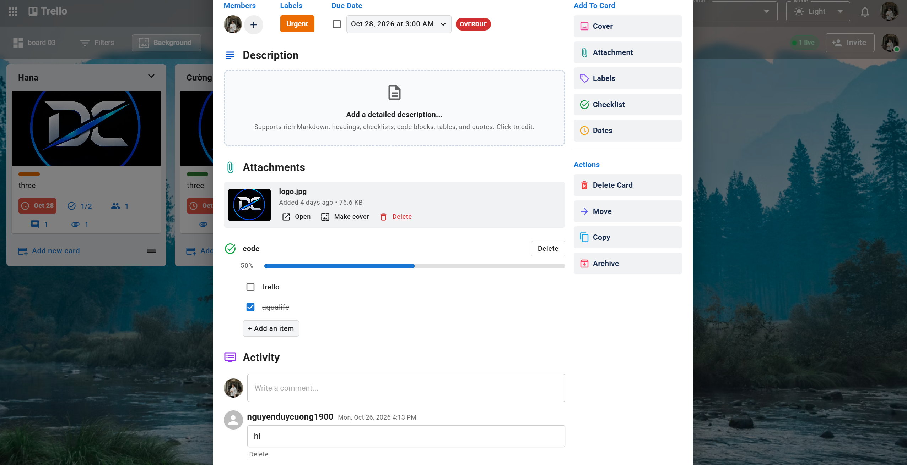

---

### 11. Bộ Lọc Thẻ Thông Minh (Filter Cards)
Hỗ trợ tìm kiếm thẻ theo từ khóa nội dung, lọc thẻ được giao cho bản thân (**Cards assigned to me**) hoặc lọc theo màu nhãn (Urgent, Normal...).

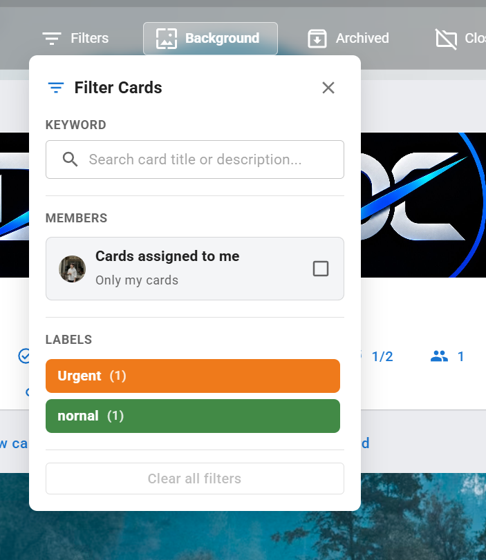

---

### 12. Tùy Biến Hình Nền Bảng (Change Background)
Cá nhân hóa không gian làm việc với kho ảnh thiên nhiên chất lượng cao từ **Unsplash**, dải màu chuyển sắc (**Gradients**), bảng màu phẳng (**Colors**) hoặc tải ảnh lên từ máy tính.

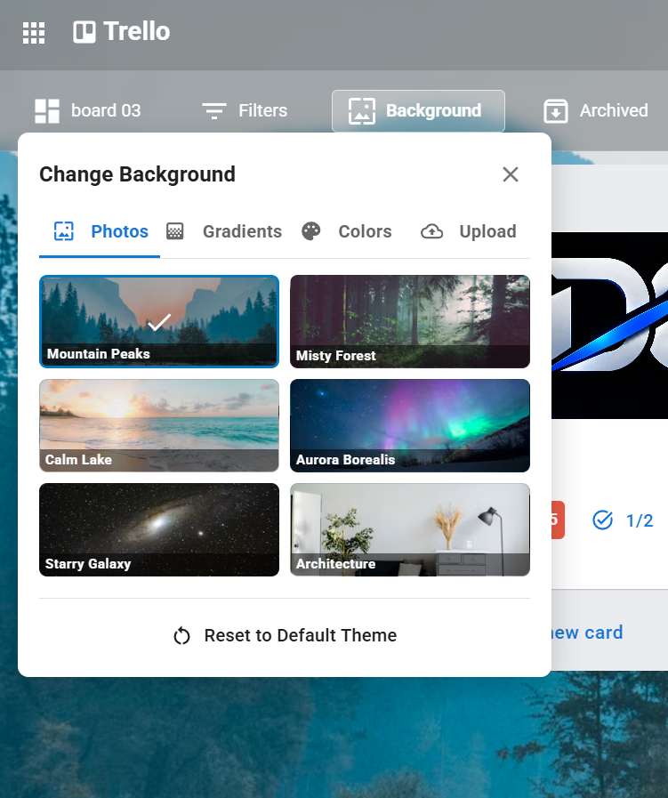

---

### 13. Ngăn Kéo Lưu Trữ (Archived Items Panel)
Quản lý các danh sách cột và thẻ đã lưu trữ. Cho phép khôi phục lại bảng (**Send to board**) hoặc xóa vĩnh viễn (**Delete**) để giải phóng tài nguyên.

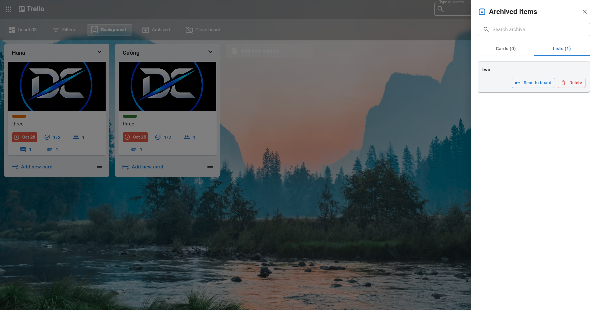

---

### 14. Mời Thành Viên Tham Gia Bảng (Invite User to Board)
Dễ dàng thêm đồng đội vào dự án bằng cách nhập email. Hệ thống sẽ tự động gửi thông báo thời gian thực đến người được mời.

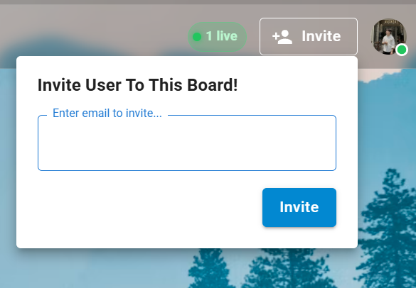

---

### 15. Trung Tâm Thông Báo (Notification Center)
Biểu tượng quả chuông trên thanh AppBar giúp theo dõi mọi lời mời và hạn chót công việc. Trạng thái thân thiện khi bạn đã xử lý hết mọi thông báo: *"You're all caught up!"*.

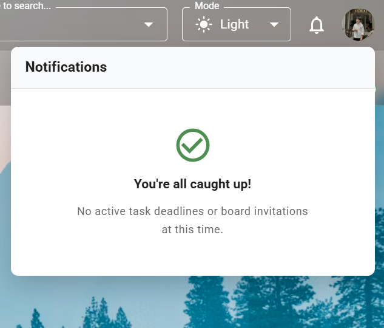

---

## 🛠 Công Nghệ Sử Dụng (Tech Stack)

### Frontend (`trello-web`)
- **Core**: React 18, Vite
- **UI Framework & Icons**: Material UI (MUI v5), `@emotion/react`, `@emotion/styled`, `@mui/icons-material`
- **Kéo thả (DnD)**: `@dnd-kit/core`, `@dnd-kit/sortable`, `@dnd-kit/utilities`
- **Quản lý State**: Redux Toolkit, Redux Persist
- **Real-time Client**: `socket.io-client`
- **HTTP Client**: Axios (với Request & Response Interceptors xử lý Dual-Auth và tự động Refresh Token)
- **Editor & Formatting**: `@uiw/react-md-editor`, Day.js, Lodash
- **Xác thực**: `@react-oauth/google`

### Backend (`trello-api`)
- **Runtime & Framework**: Node.js (>=18.x), Express.js
- **Database**: MongoDB (Native MongoDB Node.js Driver)
- **Real-time Engine**: Socket.IO
- **Validation**: Joi
- **Xác thực & Mã hóa**: JSON Web Token (`jsonwebtoken`), `bcryptjs`, `cookie-parser`, `google-auth-library`
- **Email Service**: Brevo API (`@getbrevo/brevo`)
- **Quản lý Media**: Cloudinary SDK
- **Bảo mật**: `cors`, `express-rate-limit`

---

## 🚀 Hướng Dẫn Cài Đặt & Chạy Cục Bộ (Local Setup)

### Yêu Cầu Tiên Quyết (Prerequisites)
- [Node.js](https://nodejs.org/) phiên bản **>= 18.x**
- [npm](https://www.npmjs.com/) hoặc [yarn](https://yarnpkg.com/)
- Cơ sở dữ liệu [MongoDB](https://www.mongodb.com/) (Local hoặc MongoDB Atlas)

---

### 1. Khởi Chạy Frontend (`trello-web`)

```bash
# Di chuyển vào thư mục trello-web
cd trello-web

# Cài đặt các thư viện cần thiết
npm install

# Tạo file cấu hình môi trường từ file mẫu
cp .env.example .env
```

Nội dung cấu hình trong file `.env`:
```env
VITE_GOOGLE_CLIENT_ID=your_google_client_id_here
```

Khởi chạy máy chủ phát triển (Development Server):
```bash
npm run dev
```
Ứng dụng sẽ hoạt động tại địa chỉ: `http://localhost:5173`

---

### 2. Khởi Chạy Backend API (`trello-api`)

```bash
# Di chuyển vào thư mục trello-api
cd ../trello-api

# Cài đặt các thư viện phụ thuộc
npm install

# Tạo file cấu hình môi trường
cp .env.example .env
```

Cấu hình các thông số trong file `.env` của `trello-api`:
```env
LOCAL_DEV_APP_HOST=localhost
LOCAL_DEV_APP_PORT=8017

MONGODB_URI=mongodb+srv://<username>:<password>@cluster0.mongodb.net/?retryWrites=true&w=majority
DATABASE_NAME=trello-db

AUTHOR=Duy Cuong

BUILD_MODE=dev

WEBSITE_DOMAIN_DEVELOPMENT=http://localhost:5173
WEBSITE_DOMAIN_PRODUCTION=https://trello-web-tawny.vercel.app

BREVO_API_KEY=your_brevo_api_key
ADMIN_EMAIL_ADDRESS=your_email@example.com
ADMIN_EMAIL_NAME=Trello Admin

ACCESS_TOKEN_SECRET_SIGNATURE=your_access_token_secret
ACCESS_TOKEN_LIFE=1h
REFRESH_TOKEN_SECRET_SIGNATURE=your_refresh_token_secret
REFRESH_TOKEN_LIFE=14d

CLOUDINARY_CLOUD_NAME=your_cloudinary_name
CLOUDINARY_API_KEY=your_cloudinary_key
CLOUDINARY_API_SECRET=your_cloudinary_secret
```

Khởi chạy API Server:
```bash
npm run dev
```
API Server sẽ hoạt động tại địa chỉ: `http://localhost:8017`

---

## 📁 Cấu Trúc Thư Mục Dự Án (Project Structure)

```text
trello/
├── trello-web/                   # Ứng dụng Frontend (React + Vite)
│   ├── public/                   # Tài nguyên tĩnh (Favicon, Robots.txt, Sitemap)
│   ├── screenshots/              # Toàn bộ 15 ảnh chụp màn hình minh họa
│   └── src/
│       ├── apis/                 # API client calls (Axios endpoints)
│       ├── assets/               # Hình ảnh, icons, vectors
│       ├── components/           # Components tái sử dụng (AppBar, Modal, Dialog...)
│       ├── customHooks/          # React Custom Hooks
│       ├── customLibraries/      # Cấu hình thư viện ngoài (Dnd-kit sensor...)
│       ├── pages/                # Các trang chính (Auth, Boards, Settings, 404...)
│       │   ├── Auth/             # Đăng ký, đăng nhập, kích hoạt tài khoản
│       │   └── Boards/           # Bảng Kanban, BoardBar, BoardContent, Columns, Cards
│       ├── redux/                # Redux Toolkit Slices & Store configuration
│       ├── theme.js              # Cấu hình giao diện MUI Theming & Colors
│       └── utils/                # Utilities, constants, validators, token helpers
│
└── trello-api/                   # Ứng dụng Backend API (Node.js + Express)
    └── src/
        ├── config/               # Cấu hình môi trường, CORS, Cloudinary, MongoDB
        ├── controllers/          # Request handlers xử lý logic HTTP
        ├── middlewares/          # Auth middleware (Dual-auth), multer upload...
        ├── models/               # MongoDB Database Schemas & Data access layer
        ├── providers/            # Third-party providers (Brevo Email, Cloudinary)
        ├── routes/v1/            # Định tuyến RESTful API v1
        ├── services/             # Business logic nghiệp vụ
        ├── sockets/              # Socket.IO event handlers (real-time emit/listen)
        ├── utils/                # Formatters, algorithms, JWT helpers
        ├── validations/          # Joi schema validations
        └── server.js             # Entrypoint khởi tạo Express & Socket.IO server
```

---

## 🚢 Hướng Dẫn Triển Khai (Deployment)

### Frontend Deployment (Vercel)
1. Kết nối kho lưu trữ GitHub `Trello_Web` với dự án trên **Vercel**.
2. Thiết lập thư mục gốc (**Root Directory**) là thư mục `trello-web` (nếu dùng monorepo) hoặc chọn nhánh `master`.
3. Thêm biến môi trường:
   - `VITE_GOOGLE_CLIENT_ID`: Google OAuth Client ID của bạn.
4. Vercel sẽ tự động build và cung cấp chứng chỉ SSL miễn phí.

### Backend Deployment (Render)
1. Tạo một **Web Service** mới trên **Render** kết nối với kho lưu trữ `Trello_Api`.
2. Cấu hình lệnh:
   - **Build Command**: `npm install && npm run build`
   - **Start Command**: `npm run start`
3. Khai báo toàn bộ các biến môi trường từ file `.env` vào mục **Environment** trên Render.

---

## 👨‍💻 Tác Giả (Author)

- **Nguyễn Duy Cường** (*duycuongdev*)
- **GitHub**: [@duycuongdev](https://github.com/duycuongdev)
- **Dự án**:
  - [Trello_Web Repository](https://github.com/duycuongdev/Trello_Web)
  - [Trello_Api Repository](https://github.com/duycuongdev/Trello_Api)

---

## 📄 Bản Quyền (License)

Dự án này được phát triển phục vụ mục đích học tập, nghiên cứu và xây dựng sản phẩm chất lượng cao. Giữ toàn quyền tác giả bởi Nguyễn Duy Cường.
